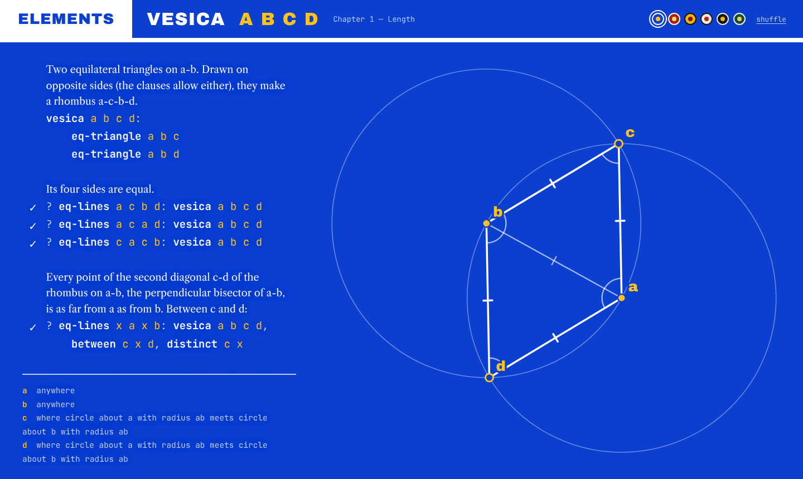

# elements

Euclidean geometry you can write, check and drag. You state geometric facts and constructions as Horn
clauses; elements checks your lemmas as you type and draws each construction the way Euclid would, with
ruler and compass, as a figure whose points you can drag.



elements comes with a book, in progress, that will cover the content of Euclid's plane geometry in its
own order, one chapter per kind of equality: length, angle, direction, area, ratio (see
[docs/book.md](docs/book.md)). The page above is from chapter 1; chapters 2 to 4 (angle, direction
and area) are written too, as far as Pythagoras and squaring a figure. The construction

```txt
vesica a b c d:
    eq-triangle a b c
    eq-triangle a b d
```

is drawn with ruler and compass, and each `?` proposition beside it carries a ✓ because the engine
proves it from the chapter's axioms.

## What it is for

**A book about Euclid that you can read and play with.** Its constructions are written as Horn clauses,
short definitions that say what a figure is. From those clauses come a figure you can drag, and checks
of what can be proved about it. That is its contribution: write a figure as clauses, and get a working
diagram and its proofs. It gives one simple way to understand what a construction is and what follows
from it. Its reader is someone curious about Euclid or about geometry, perhaps a student meeting it for
the first time, not only someone interested in logic programming.

**Second, a workbench.** How far can a system like this go: what can it practically prove and draw,
can it carry other geometries, and is it any use beyond Euclid's first few books? The book is the
first experiment, and every chapter is also a test of the system.

## Principles

How to decide what to build, and how:

- **The page is the product.** A change is worth making when a reader would notice it: a figure that
  reads well, marks that show the proposition at hand, an answer that comes while the reader still
  cares, a ✓ that can be trusted. Engine work earns its place by what it does for a page.
- **The clauses are prose.** A definition says what one would say about the figure; a lemma says what
  Euclid says. A hypothesis there only for the engine, or a statement split or shaped for speed, is a
  cost the reader pays: pay it only when there is no other way, say why in the book, and come back for
  it.
- **Every page is honest.** A ✓ means proved, and the hypotheses have a figure. The figure never
  silently disagrees with the facts: it satisfies every fact, or says which step fails and why. An
  axiom taken where Euclid argues by cases or sides is fine when the book says so; a verdict resting on
  a budget running out is not.
- **The rules are the meaning.** Anything the engine builds in (union-find, canonical forms) is
  something it has proven from the rules.
- **Dependencies come from the content.** What a proof rests on is a property of the proof, not of
  where the lemma is written: a ✓ should be able to say whether it needs the parallel postulate, and a
  check should fire only the rules that can bear on it. The order of chapters is for the reader.
- **Keep the engine general; prefer conventions over syntax.** No geometry and no relation names in the
  engine: geometry lives in the `.geo` files and the figure layer, so another geometry means new rules
  and a new figure layer. When something seems to need syntax, look first for a convention the engine
  can recognise, and make that visible.
- **The workbench must not cost the book.** Push the system as far as it goes and write down where it
  breaks ([review notes](docs/review-notes.md)). A change for generality's sake waits until a chapter or
  an experiment needs it.
- **Big changes to the logic need a reason a reader would see.** Case splits, quantifiers in heads,
  sums: each changes what a lemma means and how a page reads. Take one up when a chapter cannot be
  written honestly without it, and design it as a whole.

## Running it

```bash
npm install
npm run dev       # http://localhost:5173
npm test          # vitest, about 2½ minutes, most of it the book's lemmas
npm run build     # type-check and build to dist/
```

Pushing to `main` deploys to GitHub Pages (`.github/workflows/pages.yml`).

## A short tour

- **The scratchpad** is the page you start on. Write facts (`eq-triangle a b c`), rules
  (`midpoint m a b: between a m b, eq-lines a m m b`) and questions (`? eq-lines a b b c: eq-triangle a b c`).
  The figure redraws as you type; each `?` line gets ✓ (proven), ✗ (false: a figure breaks it), ?
  (not proven, with whether it held in every sampled figure) or ⊥ (its hypotheses contradict each
  other).
- **Drag points.** Solid points are free, ringed ones slide along a line or circle, open ones are
  determined by the construction (dragging one reverses the construction around it).
- **The figure shows what is written.** Each relation has its own drawing (`between` a finite straight
  line, `circle` a circle, `right` Byrne's square); facts inside a construction are drawn fainter the
  deeper they are. Tick marks and angle arcs mark only equalities that are stated or proven by a ✓
  lemma, and lemmas travel with their constructions. Hover an element to see where it came from (and,
  for a mark, its chain of equalities), with its source lines lit; hover a fact in the source to bring
  forward what it draws.
- **The steps** under the source describe the construction in words; touching a point (or hovering its
  step) shows the loci that placed it. If the figure cannot be built in its current position (two
  circles that no longer meet), the failing step is marked and the reason shown. A figure the planner
  cannot construct is drawn by a numerical solver instead, and the page says which points it placed.
- **Contents**: click `ELEMENTS` or the title to browse the book chapter by chapter, as cards with a
  miniature of each figure, or add predicates of your own (stored in your browser). A construction's
  page shows its definition with the propositions about it.
- **Themes**: the swatches top right; with *shuffle* on, the colours change each time you open
  something from the contents.

## How it works, in brief

The clauses form a knowledge base. A predicate's defining clause is read as *if and only if*, so
hypotheses can be unfolded into what they mean; everything else is ordinary forward chaining. The
engine recognises equality and symmetry in the rules by proving them, and uses that to run fast without
knowing anything about geometry. To draw, the facts are unfolded as the logic unfolds them, and one
table of relations (`src/geometry/relations.ts`) says what each is to the figure: the leaves become
constraints for a planner that finds a ruler-and-compass construction (each point free, sliding on one
locus, or where two loci meet), and the first drawn fact on each path is what the figure shows. Every
fact is checked on each frame. Marks come from stated equalities and proven lemmas, in classes merged
by the forward closure. See [docs/architecture.md](docs/architecture.md).

## Repository

```
src/
  language/     lexer, parser; book/ holds the bundled book, one chapter per .geo file
  kb/           inference: definitions, recognised structure, forward closure, checking
  geometry/     from facts to figures: the relation table, extraction, the construction planner, the
                figure and its marks, the numerical fallback
  composables/  page state, the knowledge base, the verification worker client
  components/   the code editor and the figure
  views/        the page
  workers/      lemma checking and the figure's forward closure, off the main thread
tests/          vitest suites (see docs/architecture.md#tests) and fixtures/
docs/           documentation
```

## Documentation

- [Book](docs/book.md): what the bundled book covers and how it is organised.
- [Language](docs/language.md): syntax and semantics, including how definitions are recognised.
- [Architecture](docs/architecture.md): how checking and drawing work, and why.
- [Design](docs/design.md): the visual design, what is built and what is planned.
- [Roadmap](docs/roadmap.md): what comes next, in order, then everything else that is open.
- [Review notes](docs/review-notes.md): what writing the book has shown about the engine, with the
  measurements of the November 2026 review (`npx vite-node scripts/bench.ts` reproduces them).
- [Proofs](docs/proofs.md): a proposal (November 2026) for proofs the engine finds, the page shows
  and an author writes, with a diagnosis of the logic engine's power and efficiency.
