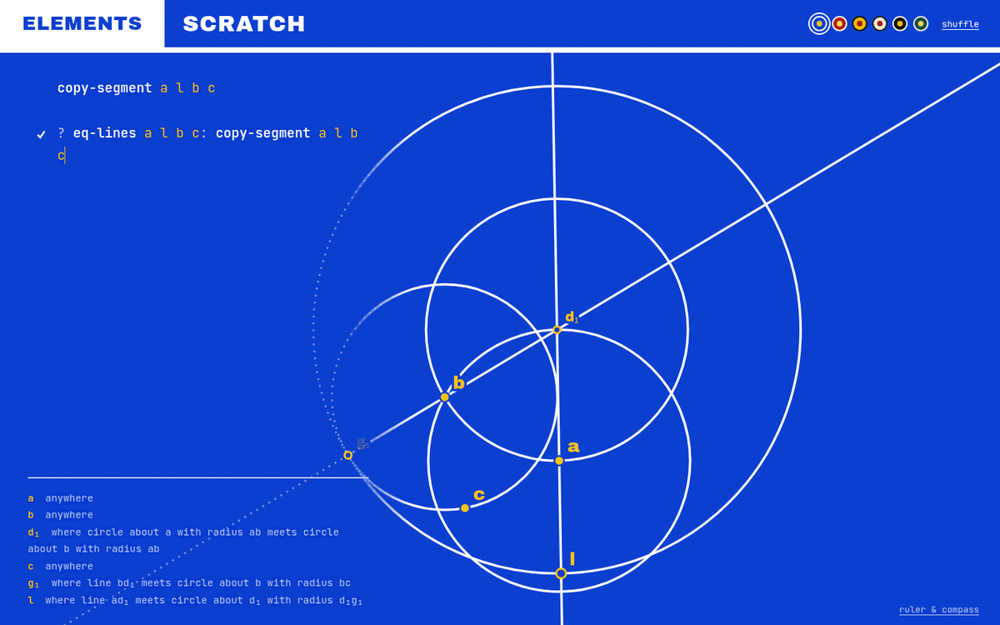

# elements

Euclidean geometry you can write, check and drag. You state geometric facts and constructions as Horn
clauses; elements checks your lemmas as you type and draws each construction the way Euclid would, with
ruler and compass, as a figure whose points you can drag.



The figure above is Euclid's second proposition, from this definition in [`euclid.geo`](src/language/euclid.geo) (comment shortened):

```txt
# I.2 — from point a, draw a segment a-l equal to the segment b-c.
copy-segment a l b c:
    eq-triangle d a b
    circle b c g
    between d b g
    circle d g l
    between d a l
```

and the lemma `? eq-lines a l b c: copy-segment a l b c` beside it carries a ✓ because the engine proves
it from Euclid's common notions in [`core.geo`](src/language/core.geo).

## Running it

```bash
npm install
npm run dev       # http://localhost:5173
npm test          # vitest, about 20 s
npm run build     # type-check and build to dist/
```

Pushing to `main` deploys to GitHub Pages (`.github/workflows/pages.yml`).

## A short tour

- **The scratchpad** is the page you start on. Write facts (`eq-triangle a b c`), rules
  (`midpoint m a b: between a m b, eq-lines a m m b`) and questions (`? eq-lines a b b c: eq-triangle a b c`).
  The figure redraws as you type; each `?` line gets ✓ or ✗.
- **Drag points.** Solid points are free, ringed ones slide along a line or circle, open ones are
  determined by the construction (dragging one reverses the construction around it).
- **The steps** under the source describe the construction in words. If the figure cannot be built in
  its current position (two circles that no longer meet), the failing step is marked and the reason
  shown.
- **Contents**: click `ELEMENTS` or the title to browse the bundled knowledge base, or add predicates of
  your own (stored in your browser).
- **Themes**: the swatches top right; with *shuffle* on, the colours change each time you open
  something from the contents.

## How it works, in brief

The clauses form a knowledge base. A predicate's defining clause is read as *if and only if*, so
hypotheses can be unfolded into what they mean; everything else is ordinary forward chaining. The
engine recognises equality and symmetry in the rules by proving them, and uses that to run fast without
knowing anything about geometry. To draw, the facts are unfolded into lines, circles and order facts,
and a planner finds a ruler-and-compass construction: each point free, sliding on one locus, or where
two loci meet. Every fact is either used by the construction or checked on each frame.

## Repository

```
src/
  language/     lexer, parser, and the bundled knowledge base (core.geo, euclid.geo, lemmas.geo)
  kb/           inference: definitions, recognised structure, forward closure, checking
  geometry/     from facts to figures: extraction, the construction planner, the numerical fallback
  composables/  page state, the knowledge base, the verification worker client
  components/   the code editor and the figure
  views/        the page
  workers/      lemma checking off the main thread
tests/          vitest suites (see docs/architecture.md#tests)
docs/           documentation
```

## Documentation

- [Language](docs/language.md): syntax and semantics, including how definitions are recognised.
- [Architecture](docs/architecture.md): how checking and drawing work, and why.
- [Design](docs/design.md): the visual design, what is built and what is planned.
- [Roadmap](docs/roadmap.md): open problems and ideas.
