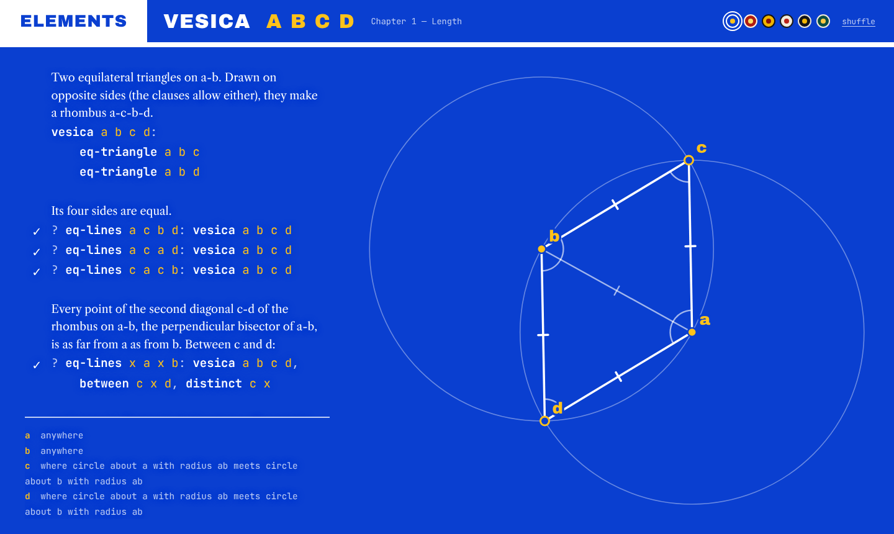
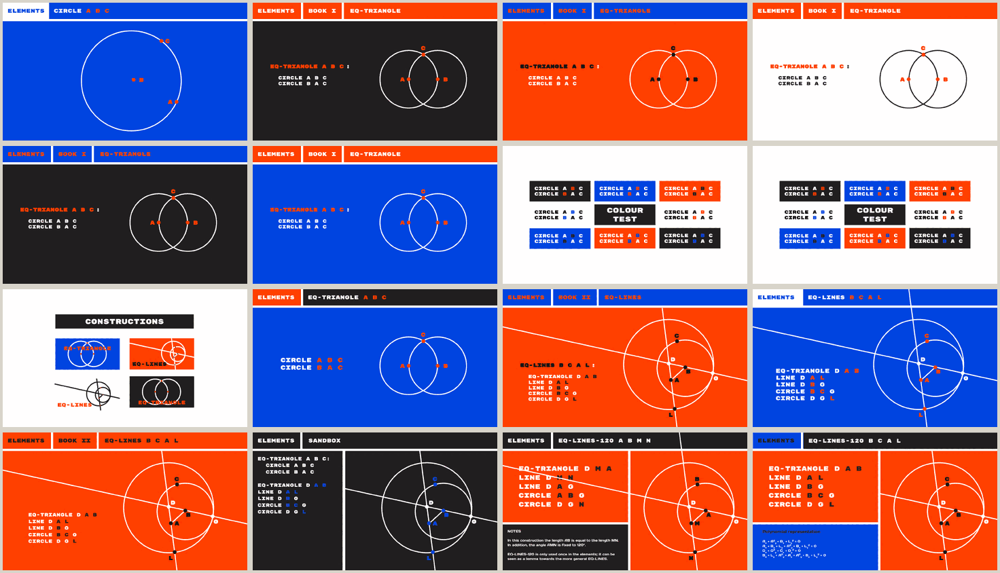

# Visual design

The interface takes its cue from Oliver Byrne's 1847 edition of Euclid, in which the proposition and its
figure share the page and colour carries the structure. It is an influence, not a pastiche.

## Principles

1. **Code and figure are the central pair**: two aspects of one object, not panes in a workbench.
2. **A composed page, not an app made of containers.** Spacing, typography and colour carry the
   hierarchy; boxes, borders, panels and overlays are used rarely and deliberately.
3. **Strictly two-dimensional space.** Surfaces sit beside or replace one another; no floating layers
   or dropdown logic as the way complexity appears.
4. **Machinery stays backstage.** Proof search, planning and solving are there when wanted, never the
   default composition. But the page must stay legible in every state, errors included, and anything
   important (a failing construction, a lemma that does not check) shows on the page itself.
5. **Colour is structural**: a small, bold, material palette; names in the code and points in the
   figure share a colour.
6. **Typography is structure too**: an assertive uppercase display face for names, a quiet monospace
   for clauses, a book serif for the running text.

The mockups that set the direction (2026), from which the bold palette, thick strokes, uppercase
voice, top strip and catalogue-of-figures idea were kept, and the heavy pseudo-De Stijl panelling and
annotation pages were dropped:

## As built

**Page.** A masthead strip (`ELEMENTS`, the name being viewed and its arguments, theme swatches), the
source on the left, and the figure filling the whole page behind it. The figure's points are fitted in
the space beside the text, while its lines and circles may run on behind it (the composition the
original brief describes: points in a chosen region, geometry across the whole page).

**Figure behind text.** Under the text column the figure turns into a dotted ghost of itself, cross-fading
back to solid strokes across a soft edge. The text and the construction steps carry a halo in the paper
colour, so the dots break around every letter; point labels have the same halo against solid lines. The
effect keeps the figure present everywhere without ever reading as part of the text.

**Points.** Large hit areas, a grab cursor, and on hover a ring and a slightly larger dot. Their look
says how they move: solid points are free, points with a standing ring slide along a line or circle,
open points are determined by the construction (dragging one re-plans the construction so that it
becomes free), and small quiet points cannot be moved. Auxiliary points (`d₁`) are smaller.

**Source.** Set as a page rather than as code. Clauses are monospace, predicate names in ink and
variables in the accent colour; comments are prose, in Libre Caslon (Byrne's edition was set in Caslon), its x-height matched to
the monospace, with the `#` shown only on the line
being edited. Names never break across lines, and wrapped lines hang: a comment under its first word,
a clause line one indent deeper than it starts. `?` lines get `✓`, `✗` (false), `?` (not
proven), `⊥` (contradictory hypotheses) or `!` (an alarm) in a gutter beside them, and anything but a
`✓` its reason in small type underneath. A line
that does not parse is underlined, with the reason underneath, and the figure stays as it was until
the text parses again; a predicate name nothing defines or uses gets a dotted underline. Completion
offers each predicate with its arguments as fields to fill in (Tab moves between them) and the start
of its doc comment; Enter after a `:` indents the body, Enter in a comment continues it, and Enter on
an empty indented or comment line steps out.

**The construction in words** sits under the source ("g₁ where line bd₁ meets circle about b with
radius bc"). If the figure cannot be constructed in its current position, the failing step is marked and
the reason appears at the bottom of the page.

**Themes.** Six palettes, each checked for contrast (text, accent and secondary text at least 4.5:1 on
the paper):

| Theme | Paper | Ink | Accent |
|-------|-------|-----|--------|
| Byrne blue | `#0a3fd0` | `#ffffff` | `#ffc21a` |
| Vermilion | `#b01c12` | `#fff4e2` | `#ffe066` |
| Ochre | `#f0b400` | `#141210` | `#8a1208` |
| Vellum | `#f3ecdc` | `#1d1b17` | `#b8221a` |
| Night | `#121419` | `#ece7dc` | `#f2b705` |
| Verdigris | `#0a4f46` | `#f3ecdc` | `#ffc845` |

Theme colours are registered CSS properties, so a change cross-fades everything, figure included.
With *shuffle* on, opening something from the contents picks a new theme.

**Contents.** Clicking the title or `ELEMENTS` replaces the page with the book's contents, one chapter
at a time: a card for each predicate, in the order the chapter defines them, with a miniature of its
figure (computed in idle time and cached), its name and its arguments. Opening a construction shows its
definition with the propositions about it, each checked.

**Equal segments** that a figure states are drawn with bold tick marks, the same number on segments of
the same length. The figure's own circles count their radii as equal segments, so the equilateral
triangle's two circles draw its three sides, one tick each, as Byrne would.

**Layers by depth.** Every line, circle and segment is drawn thinner and fainter the more deeply
nested the definition it comes from: a construction's own elements in front, the constructions it
uses behind, theirs further behind (`cut` shows three layers). The construction actually used is drawn
too, one layer below the point it places: the circle that carries a length, the line of a bisector.

**Narrow screens.** With no room beside the text, the source sits above a solid figure. Phones show
the source and the figure only (no construction steps), with one theme dot that steps through the themes.

**The tether between source and figure.** Hovering a name in the source rings its point (a
construction's own variable, such as `d` in `transfer`, rings the auxiliary point it became, `d₁`);
hovering a predicate brings forward what that atom draws and lets the rest of the figure recede;
hovering a point sets its names in the source in reverse, in the accent colour. Hovering a predicate
name a moment shows its arguments and the start of its doc comment; Cmd- or Ctrl-click opens its
page. The matching is geometric: the hovered atom is unfolded and the figure's elements drawn through
its points are brought forward, so the drawing pipeline does not have to carry where each element
came from.

## Designed, not yet built

From the original brief, in rough order of importance:

- **Reading and editing as two modes**: in reading mode the code is set as typography rather than editor
  content, with proof marks styled for the page; editing brings the editor. Transitions between them,
  and towards a margin layout when the text is long, should be continuous recompositions.
- **Text that makes room for the figure**: try a set of vertical positions for the text block, score
  their overlap with lines and circles, move (animated, with hysteresis) only on load and after a drag,
  and fall back to the margin when nothing fits.
- **A fuller index**: the cards exist; still to come are search, setting the primitives apart from the
  constructions, and grouping chapters into books.
- **Predicate views across the knowledge base**, with lemmas as optional layers (lemmas implying it,
  implied by it, mentioning it).
- **The boffin panel**: a strip that the page gives up at the bottom, hidden by default, for proof
  traces, planner and solver detail and settings; a successful proof mark links to its trace there.
- **An entry page**: a construction filling the screen with the title, the chrome arriving on first
  interaction.

## Open questions

How the index should really work; how lemma layers are shown without crowding the clauses; how much of
the technical underside to expose and where; whether colours should be permuted by context (scratchpad,
viewer, user predicates) rather than by choice; and how the composition should adapt to very long or
very large content.

The full original brief and style notes are in the repository history:
`git show a16fe3c:notes/ui-design/UI_OVERHAUL_DESIGN.md` and
`git show a16fe3c:notes/ui-design/EUCLID_STYLE_NOTES.md`.
