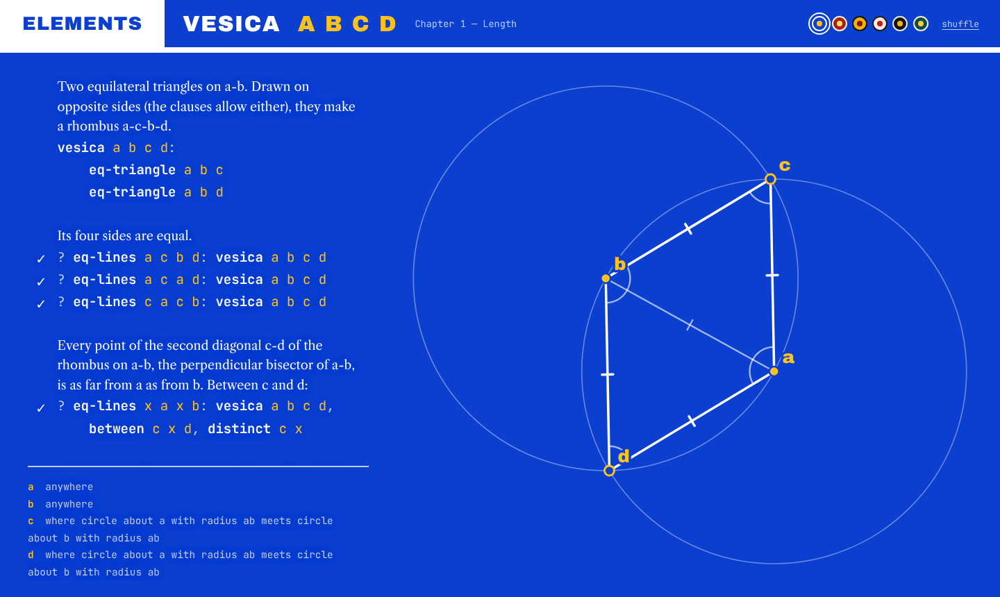
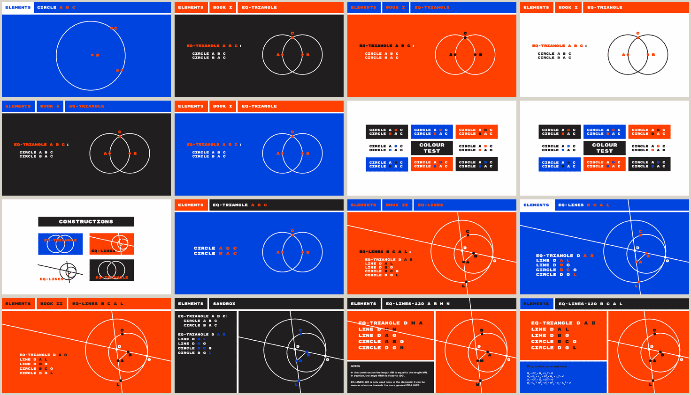

# Visual design

The interface takes its cue from Oliver Byrne's 1847 edition of Euclid, in which the proposition and its
figure share the page and colour carries the structure. It is an influence, not a pastiche.

## Principles

1. **Code and figure are the central pair**: two aspects of one object, not panes in a workbench.
2. **A composed page, not an app made of containers.** Spacing, typography and colour carry the
   hierarchy; boxes, borders, panels and overlays are used rarely and deliberately.
3. **Strictly two-dimensional space.** Surfaces sit beside or replace one another; no floating layers
   or dropdown logic as the way complexity appears.
4. **Machinery stays backstage.** Proof search, planning and solving are there when wanted, never the
   default composition. But the page must stay legible in every state, errors included, and anything
   important (a failing construction, a lemma that does not check) shows on the page itself.
5. **Colour is structural**: a small, bold, material palette; names in the code and points in the
   figure share a colour.
6. **Typography is structure too**: an assertive uppercase display face for names, a quiet monospace
   for clauses, a book serif for the running text.

The mockups that set the direction (2026), from which the bold palette, thick strokes, uppercase
voice, top strip and catalogue-of-figures idea were kept, and the heavy pseudo-De Stijl panelling and
annotation pages were dropped:

## As built

**Page.** A masthead strip (`ELEMENTS`, the name being viewed and its arguments, theme swatches), the
source on the left, and the figure filling the whole page behind it. The figure's points are fitted in
the space beside the text, while its lines and circles may run on behind it (the composition the
original brief describes: points in a chosen region, geometry across the whole page).

**Figure behind text.** Under the text column the figure turns into a dotted ghost of itself, cross-fading
back to solid strokes across a soft edge. The text and the construction steps carry a halo in the paper
colour, so the dots break around every letter; point labels have the same halo against solid lines. The
effect keeps the figure present everywhere without ever reading as part of the text.

**Points.** Large hit areas, a grab cursor, and on hover a ring and a slightly larger dot. Their look
says how they move: solid points are free, points with a standing ring slide along a line or circle,
open points are determined by the construction (dragging one re-plans the construction so that it
becomes free), and small quiet points cannot be moved. Auxiliary points (`d₁`) are smaller.

**Source.** Set as a page rather than as code. Clauses are monospace, predicate names in ink and
variables in the accent colour; comments are prose, in Libre Caslon (Byrne's edition was set in Caslon), its x-height matched to
the monospace, with the `#` shown only on the line
being edited. Names never break across lines, and wrapped lines hang: a comment under its first word,
a clause line one indent deeper than it starts. `?` lines get `✓`, `✗` (false), `?` (not
proven), `⊥` (contradictory hypotheses) or `!` (an alarm) in a gutter beside them, and anything but a
`✓` its reason in small type underneath. A line
that does not parse is underlined, with the reason underneath, and the figure stays as it was until
the text parses again; a predicate name nothing defines or uses gets a dotted underline. Completion
offers each predicate with its arguments as fields to fill in (Tab moves between them) and the start
of its doc comment; Enter after a `:` indents the body, Enter in a comment continues it, and Enter on
an empty indented or comment line steps out.

**The construction in words** sits under the source ("g₁ where line bd₁ meets circle about b with
radius bc"). If the figure cannot be constructed in its current position, the failing step is marked and
the reason appears at the bottom of the page.

**Themes.** Six palettes, each checked for contrast (text, accent and secondary text at least 4.5:1 on
the paper):

| Theme | Paper | Ink | Accent |
|-------|-------|-----|--------|
| Byrne blue | `#0a3fd0` | `#ffffff` | `#ffc21a` |
| Vermilion | `#b01c12` | `#fff4e2` | `#ffe066` |
| Ochre | `#f0b400` | `#141210` | `#8a1208` |
| Vellum | `#f3ecdc` | `#1d1b17` | `#b8221a` |
| Night | `#121419` | `#ece7dc` | `#f2b705` |
| Verdigris | `#0a4f46` | `#f3ecdc` | `#ffc845` |

Theme colours are registered CSS properties, so a change cross-fades everything, figure included.
With *shuffle* on, opening something from the contents picks a new theme.

**Contents.** Clicking the title or `ELEMENTS` replaces the page with the book's contents, one chapter
at a time: a card for each predicate, in the order the chapter defines them, with a miniature of its
figure (computed in idle time and cached), its name and its arguments. Opening a construction shows its
definition with the propositions about it, each checked.

**Equal segments** that a figure states are drawn with bold tick marks, the same number on segments of
the same length. The figure's own circles count their radii as equal segments, so the equilateral
triangle's two circles draw its three sides, one tick each, as Byrne would.

**Equal angles** are marked as Byrne marks them: concentric arcs at the vertex, the same number on
angles stated equal, and the angle's arms drawn if the figure does not draw them already.

**Layers by depth.** Every line, circle and segment is drawn thinner and fainter the more deeply
nested the definition it comes from: a construction's own elements in front, the constructions it
uses behind, theirs further behind (`cut` shows three layers). The construction actually used is drawn
too, one layer below the point it places: the circle that carries a length, the line of a bisector.

**Narrow screens.** With no room beside the text, the source sits above a solid figure. Phones show
the source and the figure only (no construction steps), with one theme dot that steps through the themes.

**The tether between source and figure.** Hovering a name in the source rings its point (a
construction's own variable, such as `d` in `transfer`, rings the auxiliary point it became, `d₁`);
hovering a predicate brings forward what that atom draws and lets the rest of the figure recede;
hovering a point sets its names in the source in reverse, in the accent colour. Hovering a predicate
name a moment shows its arguments and the start of its doc comment; Cmd- or Ctrl-click opens its
page. The matching is geometric: the hovered atom is unfolded and the figure's elements drawn through
its points are brought forward, so the drawing pipeline does not have to carry where each element
came from.

## The figure: what it draws and why

*Agreed and built November 2026. This section is the rule; the code follows it. Still open: a user's
lemmas travelling to other pages (see* Marks*), and marks from the forward closure (see* Equality
chains*).*

**The rule.** Everything the figure shows by default is something written: a fact on the page, or a
fact inside a definition the page uses (fainter the deeper), or an equality the page states or a
proof establishes. How the figure is *built* (the planner's route) is shown when a point is touched,
and in the steps under the source. Every element and every mark can say where it came from.

Until now the figure mixed three sources in one visual language, with nothing to tell them apart:
the facts; the planner's loci that no fact states (the circle about c on `eq-lines a b c d`'s page,
the perpendicular in `right`); and marks the drawing inferred on its own (ticks on the radii of the
shallowest circles). The second and third are what confused.

### Three vocabularies

Three sets of predicates matter to a figure, and they are kept apart:

1. **Where meaning stops** (the logic): unfolding goes through every definition to the open predicates.
2. **What the geometric model reads** as constraints (equations, loci, choices): `collinear`,
   `between`, `eq-lines`, `distinct`, `eq-angle`, `supp`, `eq-spread`. The planner builds from these
   leaves.
3. **What the figure draws**: the first drawn node on each path of the unfolding, leaf or definition.

They used to be one list, so the wish to draw circles decided where unfolding stopped: `circle` was
not unfolded although it is defined. Now unfolding is the logic's (built, November 2026): `circle a b
c` reaches the planner as `eq-lines a b a c` (it already treated both as equal lengths, so no plan
changed) and is drawn as a circle. A depiction can attach to any node, so a defined predicate can have
a drawing of its own without losing its constraints (Byrne's square for `right`), and a user's
predicate could be given one safely. Leaves with no geometric reading are reported on the page.

A drawable relation, fully, is a bundle of interpretations: equations (residuals, and how many degrees
of freedom they remove), loci for an unknown point given the others, choices (order facts that prune
branches and bound sliders), and a drawing. Marks (ticks, arcs) are a different kind of thing: they
depict *equivalence classes* across the whole figure, so they belong to equivalences, not relations
(see *Equality chains*). Each relation's interpretations are gathered in one table
(`src/geometry/relations.ts`): its reading by the model, whether and how it is drawn, and its
residual. Its loci join the table when the planner moves onto it; a new geometric primitive
(`parallel`) would then be one entry.

### What each relation draws

| Relation | Drawn as |
|---|---|
| `collinear a b c` | the line through the points, across the page |
| `between a b c` | the segment a–c at full strength (Byrne's finite straight line), its line continuing faint beyond the ends |
| `circle a b c` | the circle about a through b and c |
| `eq-lines a b c d` | the segments a–b and c–d, with matching tick marks |
| `eq-angle a b c d e f` | arcs at both vertices, with the arms |
| `supp a b c d e f` | side by side (one vertex, one shared arm): one arc across both, a straight angle; otherwise a dotted arc at each, which never means equal |
| `right a b c` | Byrne's small square at the vertex, and beneath it, fainter, its definition: a-b continued past b to its extension point, the right angle beside it squared too |
| `parallel a b c d` | the segments a–b and c–d, their lines continuing faint, with arrows where the figure knows them parallel |
| `triangle a b c` | its three sides, as segments; that the corners are not on one line is checked |
| `eq-area a b c d e f` | the two triangles with their sides, hatched alike (Byrne colours them) |
| `distinct` | nothing: it rules configurations out |

The word chosen is the drawing you get: `circle a b c` and `eq-lines a b a c` mean the same, and draw
a circle and two ticked segments respectively. That is deliberate.

Built (November 2026): each relation's entry in the table draws it through a pen (a line, a finite
straight line, a circle, an angle as an arc or a square); `right` has an entry of its own, so it is drawn
as a square while the planner reads its definition. Every element keeps the facts that made it, which
is how hovering a fact in the source brings its elements forward. A point only the planner's route uses
is not drawn, as the route is not.

Decided (November 2026): no point is hidden. A definition may keep its lower levels' marks to itself,
but a point outside its head is part of what it says, so it is drawn. `right` draws its definition
too (`drawsBody` in the relation table), a level deeper and so fainter: the extension point d on a-b
continued past b, and the angle c-b-d squared as well, which is the definition (an angle equal to its
own supplement) made visible. A test holds every page of the book to it.

### The planner's route: shown on touch

A locus the planner uses that no fact states is not drawn by default. Touching a point (hover, or
grabbing it to drag) shows its locus: the circle a slider runs on, the ray at a copied angle, the
bisector of a right angle, the two loci an intersection came from. Letting go hides it again. So the
figure shows what was written, and a point shows where it can go and why it is where it is.

Built (November 2026): the route is drawn thin, dashed and in the accent colour, apart from the
figure, for the point hovered or dragged, or the point of the construction step hovered in the list
under the source. A ray at a copied angle is drawn as a half-line.

### Marks: from statements and proofs

Tick marks and angle arcs mark equalities, arrows mark parallels, hatching marks equal areas, and
each is marked only if it is

- **stated**: an `eq-lines`, `eq-angle`, `parallel` or `eq-area` fact on the page or in a definition it uses; or
- **proven**: a ✓ lemma on the page, or a ✓ lemma *about a construction the figure uses*. Lemmas
  travel with their predicates: wherever `eq-triangle a b c` occurs in a figure, at any depth, the
  proven `? eq-lines a b b c: eq-triangle a b c` contributes ab = bc for those points. Matching is a
  renaming of the lemma's variables (a little matching for lemmas with several hypotheses), no search.

A page marks only what it talks about (November 2026): a proven mark is drawn if its relation is in
play there, mentioned by the figure's unfolding or concluded by one of the page's own `?` lines
(`lemmasInPlay` in figure.ts). The parallelogram's page says nothing of area, so chapter 4's lemma that
a diagonal halves it does not hatch it; drop-corner's own lemma concludes equal areas, so its hatching
stays. Marks of the constructions a page is built from are kept, at their depth, so they recede. The
thumbnails follow the same rule, with the book's `?` lines for their predicate. Whether marks from
elsewhere are left off or drawn faint (two levels deeper) is a working setting while the design
settles (the settings pane in the masthead, `useSettings.ts`); off by default.

The drawing infers no equality of its own. On `eq-triangle`'s page the three sides are ticked because
its two lemmas are ✓, and wherever `eq-triangle` is used, on the scratchpad or inside I.2, the book's
lemmas travel with it and tick its sides there too. A user's own construction draws only its circles
until a lemma about it is written on its page and checks. Proof becomes a mark, as in Byrne.

What a lemma can match is the figure's *outline*: the written facts and the definitions they use,
down to what is drawn and no further. A lemma about circles matches drawn circles, never the radii a
circle unfolds to, so a circle does not tick its own radii through a lemma that merely restates them.

Each equivalence says in the relation table how its classes are marked and read (`classMark`): equal
segments share a number of ticks at their middle, equal angles a number of concentric arcs, parallel
lines a number of arrows (chevrons) along them, all pointing one way within a class, set off the
middle towards where they point so that a side both equal and parallel to another carries both clear
of each other. Hovering reads a chain with the relation's sign: `pq = ab`, `cd ∥ ab`. Byrne marks
parallels by colour; the arrows are the schoolbook convention, which works in one ink.

Triangles of one area are hatched alike, as Byrne colours them (November 2026, chapter 4): the first
class one way, the second the other, then across and along, so that where two classes overlap the
hatchings cross. The hatching is in the ink, light enough for lines to read over it, and the hatched
triangles' sides are drawn. Hovering a hatched triangle reads its chain: `△def = △abc`. A class whose
triangles overlap or tile a figure (the four halves of a parallelogram, made by its two diagonals)
hatches the whole figure alike, which says less than it should; see the review notes.

Some relations are marks too, not equalities: a right angle's square, a supplement's arcs (`mark`
in the relation table). They are drawn wherever a ✓ lemma proves them, as ticks are: `? right a c d:
perpendicular a c d, distinct a c` puts a square at c on every figure that uses `perpendicular`. And a
class of equal angles the closure derives to be right is drawn as squares instead of arcs (see
*Equality chains*).

The figure takes distinct names for distinct points, and marks use the same convention: a lemma's
`distinct` hypothesis is met by two different names (relations.ts `byNames`), and the closure assumes
`distinct` of every two points of the figure, saturating again without it should that contradict the
facts (`src/geometry/closure.ts`).

Only proven lemmas travel. Book lemmas are all ✓ (the tests require it), and a page's own lemmas lend
their marks to its figure once they check. Still to build: a user's lemma travelling to other pages,
which needs its verdict cached per knowledge base, computed in idle time as thumbnails are. A ✗ or ?
lemma never marks anything. A nested construction's marks appear at its depth, as faint as its
circles; a limit on how deep marks are taken from is the dial if deep figures get busy.

### Equality chains

Marks are computed in two steps. First every known equality, stated or proven, at every depth, is put
into classes: one union-find per relation the engine has *recognised* as an equivalence (structure.ts:
`eq-lines` on pairs, `eq-angle` on triples), so the drawing knows no relation by name. Then the
visible members of each class are marked. A deep equality x = y, joined at the surface to p = x and
y = q, gives p and q the same ticks even when x and y are hidden. A class with one visible member is
not marked: a tick must have something to be equal to on screen.

The union-find keeps the edges it merged, so a mark can explain itself as a chain:
*p = x (line 7) = y (proven on transfer's page, hidden) = q (line 8)*.

Built (November 2026) in `src/geometry/marks.ts`: the figure's marks are classes of blocks, one
union-find per recognised equivalence, each edge kept with its source (the stated fact, or the lemma
and the facts it matched); `chain` gives the path between two members. Blocks of two points are drawn
as ticks and blocks of three as arcs, which is the only place the drawing looks at a block's size.

Union-find alone captures symmetry and transitivity only, and that under-merges: the hexagon's five
equilateral triangles each prove their own three angles equal, nothing links one triangle's angles to
another's, and five classes drew 1 to 5 concentric arcs, 45 in all. So classes are then merged by the
forward closure of the figure's facts (built November 2026: `closureQueries` and `mergeByClosure` in
marks.ts, answered in a worker, `useClosure.ts`). Two classes are one when the engine derives a member of
each equal. The members stay those stated or proven: the closure joins classes, it adds no marks. While the
closure is pending the figure draws only the classes that cannot change (a relation's only class), so it
never shows a mark it will take back; the rest appear when the answer arrives, a second or few. Answers
are remembered across visits (localStorage, keyed by the rules, the facts and the questions), so the
book's figures and thumbnails wait only on the first visit. A join is
explained as *follows from the figure's facts*, until proof traces can say how. The closure is also asked, of each class, whether
its members have a mark relation on one block (`right` of an angle); a class that does is drawn with
that relation's drawing. Equalities the book cannot derive stay apart: the circumcentre's equilateral
triangles on two different sides keep two classes of arcs, since showing both are 60° needs I.32 (a
triangle's angles make two right angles), which needs parallels.

### Where each element came from

Hovering an element of the figure says what made it and highlights its source:
*circle about a through b, from `eq-triangle a b c` (line 2), one level down*; a tick explains its
chain as above. This completes the tether (source → figure, built) in the other direction
(figure → source). It needs each drawable fact to remember the written fact it was unfolded from,
as it already remembers its depth.

Built (November 2026): each fact of the extraction keeps the index of the written fact it came from,
and each element of the figure the facts that made it. Hovering an element puts its provenance in the
status line (`src/geometry/provenance.ts`), lights the source lines it came from, and brings forward
what the same facts draw; hovering a mark brings forward its whole class and reads its chain, e.g.
*pq = bc (stated: eq-lines b c p q (line 2)) = al (proven, of transfer a b c l (line 1))*.

## Constructed or solved

Built November 2026 (options 1 and 2 of the four discussed; 3 and 4 below are still open). A figure
the planner cannot construct is drawn by the numerical solver, and the page now says which points
it placed and which facts it was left to meet.

- **Which facts, which points** (`unconstructed` in `src/geometry/construction.ts`). The plan is
  drawn from a dozen sampled parameters; a fact that fails in every drawing it completes is one the
  construction does not give, only checks. Each is said to place the point of its own the plan
  places last, a named point before an auxiliary one: in an equiangular triangle `c`, and in four
  right angles `c` again, not the auxiliary point of the angle copied there. The workspace solves
  once (`solution` in `useWorkspace.ts`) and checks each such fact on the solved figure to within
  1e-4: the solver stops within about 1e-6 of every fact, which no figure can show, and one it fails
  to meet is off by far more.
- **A solved point is a pencilled asterisk**, three uneven strokes not quite meeting, in one of four
  hands chosen by its name so that no two look stamped and none changes as the figure redraws
  (`src/components/asterisks.ts`). The other points keep their markers; any of them drags, the
  solver following. Tried and dropped: a hollow diamond (read as just another marker), a blurred
  dot, a dotted ring, a cloud of dots, a trembling dot and a scribble.
- **The steps are a key**: each point's marker as the figure draws it, its name, how it is placed.
  A solved point's step ends "then found by solving", and below the steps each fact no step
  constructs is named ("Not constructed: eq-angle a b c b c a. The solver places c so that it
  holds.", with ", from right b c d" for a fact unfolded from a written one). Hovering it lights it
  in the figure and its line in the source; one the solver did not meet is underlined.
- **A plate at the foot of the figure**, in the masthead's manner, a tag in the display face beside
  the words in mono, in the theme's own colours. Solved: the tag a block of ink (✱ SOLVED), the words
  on paper inside a rule of ink, "Points c, f and i placed by the numerical solver." An error, the
  whole plate in the accent with a hard offset shadow of ink and a slight tilt: the solver met no
  figure (NOT MET), the construction cannot be carried out from here (STUCK), or a fact does not
  hold in this drawing (NOT MET). Hovering an element still shows where it came from instead.
  Tried and dropped: themes that change with the state (a pencil grey, a violet; Vermilion for
  errors), which read as a change of theme rather than news about the figure.

Still open from the discussion:

3. **A different hand for a whole solved figure**: pencilled rather than inked, so Byrne's crisp line
   always means constructed. Too coarse once figures are hybrid.
4. **The other branches**: where a point took one of several branches (which ray, which intersection),
   touching it shows the others faintly. Unsigned angles let four equal angles make a crossed
   quadrilateral as well as a rectangle, and the planner may draw either.

## Designed, not yet built

From the original brief, in rough order of importance:

- **Reading and editing as two modes**: in reading mode the code is set as typography rather than editor
  content, with proof marks styled for the page; editing brings the editor. Transitions between them,
  and towards a margin layout when the text is long, should be continuous recompositions.
- **Text that makes room for the figure**: try a set of vertical positions for the text block, score
  their overlap with lines and circles, move (animated, with hysteresis) only on load and after a drag,
  and fall back to the margin when nothing fits.
- **A fuller index**: the cards exist; still to come are search, setting the primitives apart from the
  constructions, and grouping chapters into books.
- **Predicate views across the knowledge base**, with lemmas as optional layers (lemmas implying it,
  implied by it, mentioning it).
- **The boffin panel**: a strip that the page gives up at the bottom, hidden by default, for proof
  traces, planner and solver detail and settings; a successful proof mark links to its trace there.
- **An entry page**: a construction filling the screen with the title, the chrome arriving on first
  interaction.

## Open questions

How the index should really work; how lemma layers are shown without crowding the clauses; how much of
the technical underside to expose and where; whether colours should be permuted by context (scratchpad,
viewer, user predicates) rather than by choice; and how the composition should adapt to very long or
very large content.

The full original brief and style notes are in the repository history:
`git show a16fe3c:notes/ui-design/UI_OVERHAUL_DESIGN.md` and
`git show a16fe3c:notes/ui-design/EUCLID_STYLE_NOTES.md`.
